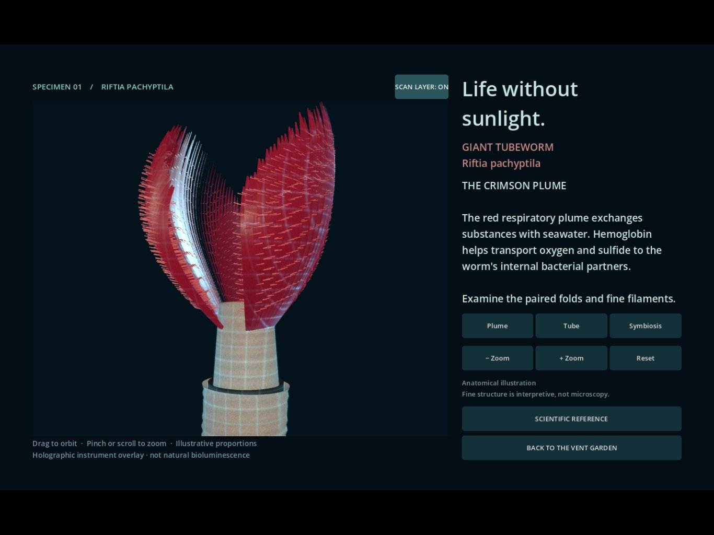
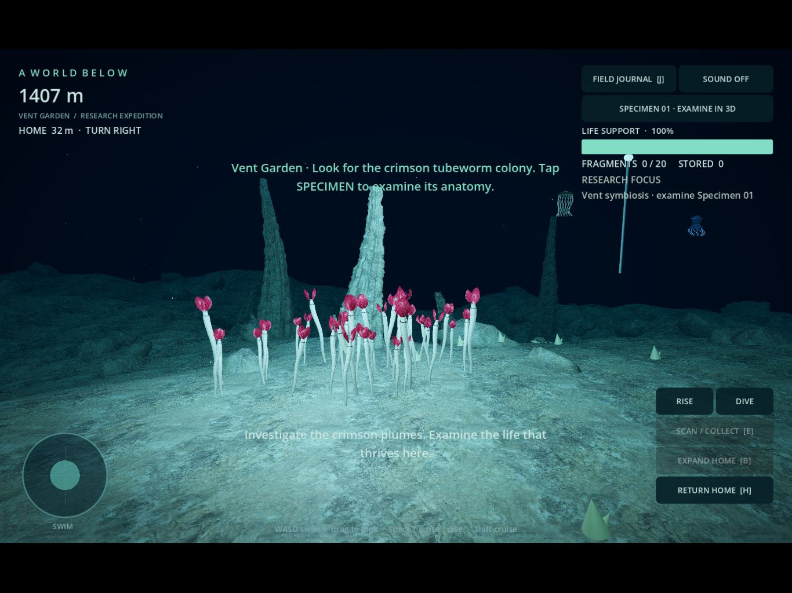
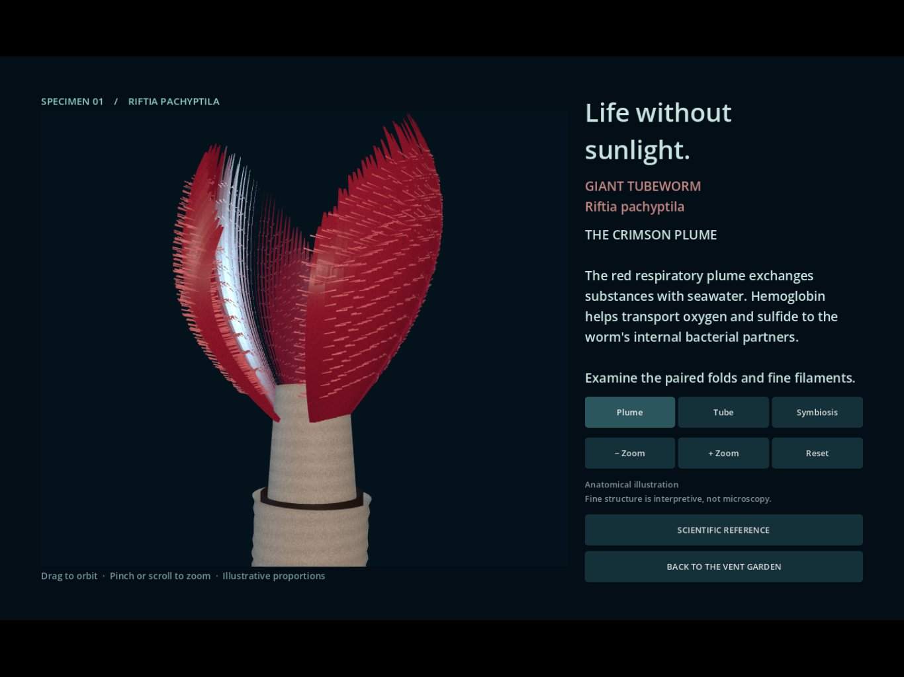
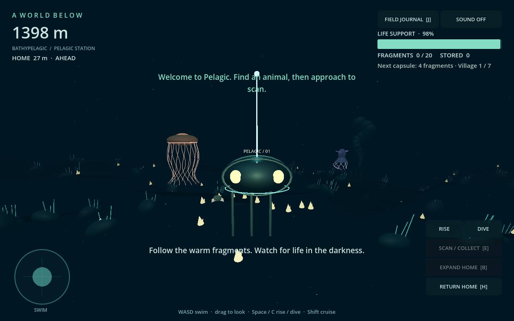

# A World Below

A free, open-source 3D deep-ocean exploration game, built with **Godot 4.6.3**.
Search for extremophiles and unusual organisms, examine their adaptations in
3D, and develop research-inspired technology for an underwater village. Visual
detail is the priority; the generated world grows around that experience.

## Water & Light study

Swimming now responds to currents, thrust, and water-relative drag. Nearby
particles drift independently of the camera, and fast movement near the floor
stirs sediment. Try SOUND ON for the movement-responsive wash; SWAY OFF reduces
camera motion and optical shimmer.

In **SPECIMEN 01**, toggle **SCAN LAYER** for a holographic research shell with
contour highlights and a slow sweep. It is identified as an instrument effect;
the organism's natural appearance remains the default. See
[water and scan notes](docs/WATER_AND_SCAN.md).



## Vent Garden visual study

The current build focuses on a compact vent habitat and a detailed, rotatable
Riftia tubeworm illustration. Use **SPECIMEN 01** to enter a separately lit 3D
study, orbit the model, zoom in, and focus on its plume, tube, and symbiosis.
The model is an anatomical illustration, not a measured scientific specimen.




New production assets include original Blender source models, reproducible
geometry-generation code, CC0 rock materials, and underwater rendering shaders.
See [the art direction and quality gate](docs/ART_DIRECTION.md). The research-to-
technology loop is the design direction; it is not fully implemented yet.

The earlier fragment/village loop remains available. Terrain uses a consistent
seed, so revisiting an area recreates the same geometry.



## First Descent prototype

- Streamed seafloor, a descending trench, stylized vent plumes, and marine snow.
- First-person swimming with inertia, a dive light, keyboard and touch controls.
- Three original animated animal silhouettes: Atolla jelly, dumbo octopus,
  and giant isopod. Scan them to unlock sourced field-journal entries.
- Collect fragments, deposit them near home, and build six additional capsules.
- Life support, home bearing, emergency rescue, and local saved progress.
- Single-threaded Web export for WebGL 2 browsers, plus native Godot play.
- No paid APIs, accounts, tracking, remote inference, or downloaded art assets.

This is a working foundation, not a finished scientific simulation. The initial
region is bathypelagic, around 1,400 m. Dedicated abyssal/hadal biomes and
extremophile communities are future work. Animal scale, colors, abundance, and
coexistence are artistic simplifications. See [science notes](docs/SCIENCE.md)
and [roadmap](docs/ROADMAP.md).

## Play locally

Install the free [Godot 4.6.3 standard editor](https://github.com/godotengine/godot-builds/releases/tag/4.6.3-stable),
import `project.godot`, and press **F5**. Or run `godot --path .`.

On a tablet, play an exported build hosted over HTTPS in a current Safari or
Chrome browser, preferably in landscape. The repository URL does not run the
game. [Play the current study on GitHub Pages](https://whitewolfcreativeworks-coder.github.io/A-World-Below/).
Actual iPad Safari
performance has not yet been verified on a physical device.

| Action | Keyboard / mouse | Touch |
| --- | --- | --- |
| Swim | WASD or arrows | Left swim pad |
| Look | Drag open water | Drag open water |
| Rise / descend | Space / C | Hold RISE / DIVE |
| Faster movement | Shift | Not yet available |
| Scan / collect | E | Context action button |
| Journal | J | FIELD JOURNAL |
| Build capsule | B near home | EXPAND HOME |
| Emergency recall | H, then confirm | RETURN HOME, then confirm |
| Pause / resume | Escape | Open journal |

Scan within 16 m; collect within 7 m. Returning within 22 m of the original
station deposits cargo and refills life support. The first upgrade costs four
fragments; costs increase by two each time. Recall or running out of air loses
half your cargo, retaining the journal, stored fragments, and village. Life
support has a five-minute capacity.

## Build a browser version

Install matching Godot export templates, then:

```sh
godot --headless --path . --editor --import --quit
mkdir -p build/web
godot --headless --path . --export-release Web build/web/index.html
python3 tools/package_web.py
python3 -m http.server 8000 --directory build/web
```

Open `http://localhost:8000`. WebAssembly needs HTTP(S); do not double-click
the HTML. Threads are disabled, so special cross-origin isolation headers are
not required. WebGL 2 is required. Engine files total roughly 38 MB uncompressed;
static hosts should enable HTTP compression.

`tools/install_godot.py` installs the pinned Linux editor and Web templates into
project-local `.tools/` without administrative privileges. The GitHub workflow
runs tests and produces a browser-build artifact. It does not publish a site.

## Test

Use separate user-data directories to protect player saves:

```sh
XDG_DATA_HOME=/tmp/awb-core-tests godot --headless --path . --script tests/test_core.gd
XDG_DATA_HOME=/tmp/awb-expedition-tests godot --headless --path . --script tests/test_expedition.gd
```

Checks cover seed repeatability, chunk seams, depletion after revisiting,
scanning, cargo limits, building, rescue, modal pause, and saving.
`tests/test_specimen.gd` also checks that detailed 3D geometry loads, anatomy
views frame correctly, orbit works, and inspection preserves expedition state.
`tests/test_water.gd` checks drag, coasting, current entrainment, frame-rate
consistency, world-anchored particles, and the saved comfort preference.

Optional browser smoke check (requires a local Playwright installation):
`node tools/test_browser.cjs`. Set `CHROMIUM_PATH` if using a system browser.
It captures screenshots for visual review; it does not replace physical iPad testing.

## Saving and licenses

Godot's `user://expedition_v1.json` stores the seed, discoveries, depletion IDs,
carried/stored fragments, and village. Sessions start near home. Saves are local
to the device and browser origin; clearing site data or using private browsing
may remove them. There is no cloud save.

Original code and procedural artwork are **MIT licensed**. Commercial use is
allowed with required notices; MIT also permits others to redistribute the work.
See [LICENSE](LICENSE), [THIRD_PARTY_NOTICES.md](THIRD_PARTY_NOTICES.md), and `LICENSES/`.

Blender is an available offline authoring tool, not a runtime dependency. Larger
fluid solvers, voxel extensions, and AI models have not been added until the
prototype demonstrates a specific need.
